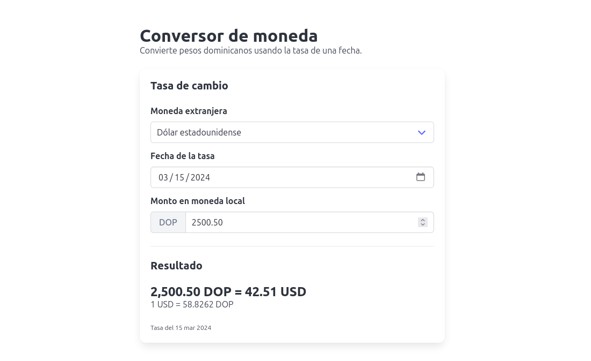

# Currency Converter

A web app that converts Dominican pesos (DOP) to other currencies using the exchange rate of a specific date. The interface is in Spanish.



## Features

- Convert DOP to 15 foreign currencies and units, including USD, EUR, GBP, CAD and JPY
- Look up historical rates from 2004 onward
- See results update as you type, without a page reload
- Get a clear message when a currency has no rate for the selected date

## Tech stack

- ASP.NET Core MVC on .NET 10
- [Bulma](https://bulma.io/) and [bulma-toast](https://github.com/rfoel/bulma-toast) for the interface
- [ClosedXML](https://github.com/ClosedXML/ClosedXML) to read the rates from Excel
- [FluentValidation](https://github.com/FluentValidation/FluentValidation) and [ErrorOr](https://github.com/amantinband/error-or) for validation and error handling

## Getting started

You need the [.NET 10 SDK](https://dotnet.microsoft.com/download).

```bash
git clone https://github.com/briangomezDev/CurrencyConverter.git
cd CurrencyConverter/CurrencyConverter
dotnet run
```

Then open the URL shown in the console, which is `http://localhost:5253` by default.

Run the app from the inner `CurrencyConverter` folder, because the rates file is located relative to the working directory.

## Exchange rate data

Rates are read from an Excel workbook included in the repository: [`CurrencyConverter/wwwroot/resource/TASAS_CONVERTIBLES_OTRAS_MONEDAS.xlsx`](CurrencyConverter/wwwroot/resource/TASAS_CONVERTIBLES_OTRAS_MONEDAS.xlsx).

The app doesn't fetch live rates, so results only cover the dates in that file. To add newer rates, replace the workbook with an updated copy that has the same layout.

## API

The page gets each rate from a single endpoint, `POST /Currency/GetCurrencyRate`:

```json
{
  "CurrencyCode": "DOLAR ESTADOUNIDENSE",
  "Day": 15,
  "MonthCode": "Mar",
  "Year": 2024
}
```

`CurrencyCode` uses the currency names from the workbook, and `MonthCode` uses Spanish abbreviations (`Ene`, `Feb`, `Mar`, and so on).

A successful response returns the value of one unit of that currency in DOP:

```json
{ "success": true, "currencyRate": 58.8262 }
```

If the request is invalid or there is no rate for that date, the response is still HTTP 200, with `success` set to `false`:

```json
{ "success": false, "errorMessage": "No hay tasa para esta moneda en esa fecha. Prueba con otra fecha." }
```
